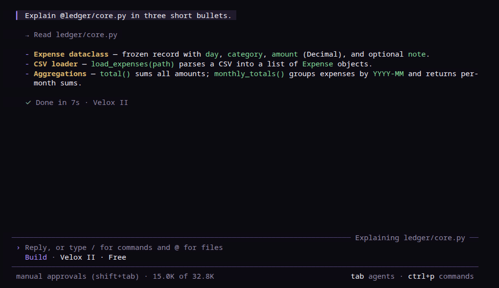

<p align="center">
  <a href="https://praex.ai">
    
  </a>
</p>
<h1 align="center">Praex</h1>
<p align="center">The AI coding agent that answers the question.</p>
<p align="center">
  <a href="https://praex.ai">praex.ai</a> ·
  <a href="https://praex.ai/download">Download</a> ·
  <a href="https://praex.ai/chat">Chat in the browser</a>
</p>

<p align="center">
  
</p>

---

Praex is an open source (MIT) AI coding agent for the terminal. It reads your codebase, edits files, runs commands, and keeps sessions you can come back to. Use it with your own key for any major provider or with a model running on your own machine. No Praex account is needed for either.

## Install

```bash
curl -fsSL https://praex.ai/install.sh | bash
```

Prebuilt binaries for Linux x64 and macOS (Apple Silicon and Intel), with SHA256 checksums, are also on the [Releases](https://github.com/ailucius/praex-cli/releases) page.

## Use your own key

Set the provider's usual environment variable and start Praex:

```bash
export ANTHROPIC_API_KEY=...   # or OPENAI_API_KEY, GEMINI_API_KEY, OPENROUTER_API_KEY, ...
praex
```

Or store a key with `praex auth login`. Works with OpenAI, Anthropic, Gemini, Groq, DeepSeek, Mistral, OpenRouter, xAI, and any OpenAI-compatible endpoint. `praex models` lists what is available. Usage with your own key is unlimited and free.

## Local models

Point Praex at Ollama, LM Studio, llama.cpp, vLLM or any other OpenAI-compatible server. Put this in `praex.json` in your project (or in `~/.config/praex/praex.json` for every project):

```json
{
  "$schema": "https://praex.ai/config.json",
  "provider": {
    "ollama": {
      "npm": "@ai-sdk/openai-compatible",
      "name": "Ollama (local)",
      "options": { "baseURL": "http://localhost:11434/v1" },
      "models": { "qwen3-coder:30b": { "name": "Qwen3 Coder 30B" } }
    }
  }
}
```

## Praex hosted models (optional)

Praex also runs hosted models we post-train and serve on our own GPUs. Sign in with `praex login` to use them:

| Tier | Model | Plan |
|---|---|---|
| Velox | fast daily driver | Free |
| Faber | heavier coding and reasoning | Pro |
| Lucia | frontier-class flagship | Max |

**No nannying.** Praex models answer the question without moralizing, lecturing, or refusing legitimate work. There is a hard floor for genuinely dangerous content, and nothing else.

## Highlights

- **TUI** built for real work: folded tool output, sessions, themes
- **Permission modes** · manual approval by default, loosen when you trust it
- **Headless runs** · `praex run "fix the failing test"` for scripts and CI, `praex serve` for a local server
- **/rc** · Remote Control: keep a session running here and continue it from your phone or the web (Praex account)
- **Web search** on hosted tiers, permission-gated per query
- **Memory** · persistent per-user memory across sessions

## Build from source

Requires [Bun](https://bun.sh).

```bash
bun install
cd packages/opencode
bun run script/build.ts --single
./dist/opencode-linux-x64/bin/opencode --version
```

## Built on OpenCode

Praex is a fork of [OpenCode](https://github.com/anomalyco/opencode) (MIT). We keep its excellent agent core, including support for every provider above, and add our own work on top: stricter permission checks for destructive commands, an agent loop that carries on when a step stalls, a self-check after headless runs, Remote Control (/rc), persistent memory, and optional hosted Praex models. Upstream attribution is preserved in [LICENSE](LICENSE) and [THIRD-PARTY-NOTICES.md](THIRD-PARTY-NOTICES.md).

## License

[MIT](LICENSE)
